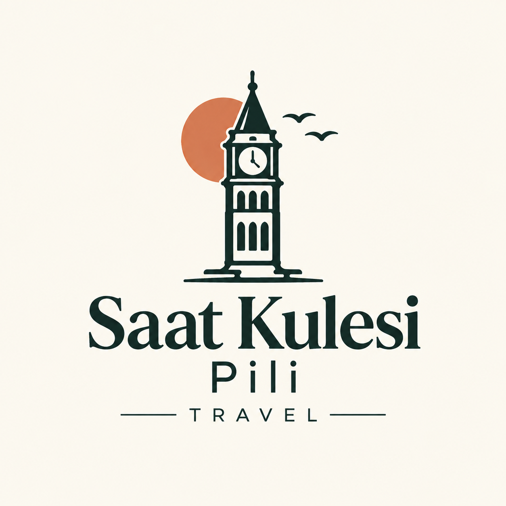

<p align="center">
  
</p>

<h1 align="center">Discover Cappadocia | Tours & Activities</h1>

<p align="center">
  A modern, responsive tourism and travel agency web application designed for exploring Cappadocia's breathtaking landscapes, hot air balloons, and cultural tours.
</p>

<p align="center">
  <a href="#about">About</a> •
  <a href="#features">Features</a> •
  <a href="#technologies">Technologies</a> •
  <a href="#project-structure">Project Structure</a> •
  <a href="#getting-started">Getting Started</a>
</p>

---

## 🌍 About

**Discover Cappadocia** is a front-end web application crafted to offer users an immersive journey into the heart of Turkey's magical region, Cappadocia. From sunrise hot air balloon flights and ATV safaris to historical red/green tours and pottery workshops, the platform provides seamless tour browsing, filtering, and booking experiences.

---

## ✨ Features

- **Interactive Hero Carousel:** Stunning visuals showcasing the magic of Türkiye and Cappadocia adventures.
- **Tour Search & Filtering Form:** Quick selection tool for tour dates, specific activities, and guest counts.
- **Service Showcases:** Dedicated sections highlighting top experiences (Hot Air Balloons, ATV Safaris, Horse Riding, Red Tours, Pottery Workshops).
- **Destination Guide:** Curated cards exploring famous spots like Göreme Open Air Museum, Love Valley, Paşabağ Valley, and Uçhisar Castle.
- **Testimonials Slider:** Guest reviews and ratings from satisfied travelers.
- **Meet the Team:** Introduction to professional coordinators, heritage guides, and expedition leaders.
- **Fully Responsive Design:** Optimized layouts providing seamless user experiences across desktop, tablet, and mobile devices.

---

## 🛠️ Technologies

This project is built using modern front-end web standards:

* **HTML5** & **CSS3** (Custom styling with modular structure)
* **Bootstrap 5.3.8** (Responsive grid system and UI components)
* **Font Awesome 6.5.1** (Modern iconography)
* **Google Fonts** (Roboto typography)

---
## 🎥 Project Preview

You can watch the project preview below:


---

## 📁 Project Structure

```text
minimal_yasam_urunleri/
│
├── index.html          # Main HTML structure
├── style.css           # Core styling rules
├── responsive.css      # Media queries and mobile layout adjustments
└── img/                # Image assets (tours, team members, destinations)


